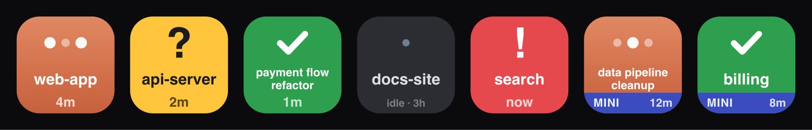

# Claude Sessions — Ulanzi D200 status board

Turns 5–8 keys on the Ulanzi D200 into a live status board for concurrent
Claude Code sessions. Each key shows one session: what project it's in, what
state it's in, and how long it's been there. The amber "blocked on you" state
is designed to be unmissable in peripheral vision.



A **web board** mirrors the same tiles in a browser window (or a standalone
desktop app via Safari's Add to Dock) with identical press behavior — handy
when the deck is out of reach, and it works [without a deck at
all](#no-deck-headless-mode).

> **Requirements:** macOS 12+, Ulanzi Studio 3.0+, and Claude Code (the status
> display is driven by Claude Code hooks). **macOS only** — the press-to-focus,
> Claude Desktop integration, and setup scripts rely on macOS-specific APIs
> (`osascript`, the `claude://` scheme, `~/Library` paths). The status display
> is OS-agnostic in principle, but focus/jump is not yet ported to Windows.

## Architecture

```
Claude Code hooks (~/.claude/settings.json)
        │ async curl POST per event (max 1s, || true — never blocks Claude)
        ▼
HTTP server  127.0.0.1:9210                   plugin/hook-server.js
  (hook receiver + web board routes)
        ▼
SessionManager  session_id → state machine    plugin/session-manager.js
        ▼                     + slot assignment
Tile renderer  state → 200×200 SVG data URL   plugin/renderer.js  (cached)
        ▼                                  ▼
Ulanzi Studio WebSocket (127.0.0.1:3906)   Web board  GET /board
plugin/app.js + vendored SDK               plugin/board.js
        ▼
D200 keys (SlotRegistry orders keys row-major) plugin/slot-registry.js
```

Everything runs in the single Node.js main service that Ulanzi Studio spawns
(`plugin/app.js`) — or that you run standalone in [headless
mode](#no-deck-headless-mode). No external processes, no cloud, loopback only.

The hook receiver binds `127.0.0.1` explicitly and is intentionally
unauthenticated: any process on this machine can POST a session event, exactly
like the Claude Code hooks do. This is a conscious trade-off — the listener is
not reachable from the LAN, the payload is validated to look like a hook event,
and the only effect of a forged event is a wrong tile. Remote machines reach it
over an SSH tunnel you set up, not over the open network. Don't expose the port
beyond loopback. Board *actions* (press/clear) are held to a stricter bar: they
require a custom header, so a malicious website can't trigger them with blind
cross-origin POSTs to localhost.

## States

| State | Tile | Entered on | Left on |
|---|---|---|---|
| `empty` | near-black | slot has no session | session assigned |
| `idle` | lighter card, bright name, `idle · <time>` | acknowledge press | any activity |
| `thinking` | terracotta gradient, pulsing dots (1 fps) | `UserPromptSubmit`, any tool event | `PermissionRequest`/`Notification` → waiting; `Stop` → done; `StopFailure` → error |
| `waiting` | **amber, bold "?"** — Claude is blocked on YOU | `PermissionRequest`, `Notification` (permission/idle prompt) | any tool event (heartbeat) → thinking |
| `done_unread` | green, check | `Stop` (turn finished) | key press → idle; new prompt → thinking |
| `error` | **red, bold "!"** — the turn hit an API error | `StopFailure` (rate limit / overloaded / auth) | key press → idle; new prompt or tool event → thinking |

Remote sessions add a machine-colour footer (`MACHINE` left, time right).
Tool-level failures (`PostToolUseFailure`) are treated as heartbeats, not
errors — Claude usually retries — so only turn-level `StopFailure` shows red.

On `SessionEnd` a session is kept, not removed: a mid-work session becomes
`done` (there may be output to review), while `idle`/`done`/`error` are left
as-is. Slots free only on long-press or after the stale timeout (default
30 min without events).

**The permission-resume gap.** No Claude Code hook fires when work resumes
after you approve a permission dialog. This plugin treats *any* tool event as
a heartbeat that forces the session back to `thinking`, so a key can show
amber for the duration of the first tool call after an approval (long `Bash`
runs = minutes), then self-corrects. This is inherent to the hooks API, not a
bug to fix here.

## Key presses

| Press on | Effect |
|---|---|
| green (`done_unread`) | acknowledge → idle (session keeps its key) |
| any lit key | jump to / focus the session, per the **Focus app** setting (below) |
| any, held ≥ 600 ms | force-clear the slot (session removed) |

What "jump" means depends on Focus app: Claude Desktop opens the session via
its `claude://resume` deep link; `Terminal (resume)` opens Terminal.app running
`claude --resume` in the session's directory; a plain terminal choice just
brings that app to the front (app-level, can't target the specific window).
Remote sessions (from another machine) always resume over SSH in Terminal
regardless of this setting.

First focus press may trigger a macOS Automation permission prompt for
Ulanzi Studio → allow it.

## Web board

The same board, in a window: open <http://127.0.0.1:9210/board> while the
plugin is running. It shows **every** live session (not just the ones with a
physical key) as the same tiles the deck renders, in the same order, updating
live — remote machines' sessions included. Tiles reflow responsively: size the
window for the grid you want (5 tiles wide ≈ the deck's layout).

Presses behave exactly like the physical keys — **click** = press (acknowledge
+ jump), **hold ≥ 600 ms** = clear (the tile shows a red ring when the hold
arms). Same code path, not a reimplementation.

To make it a small desktop app: open it in Safari → **File → Add to Dock**,
then drag the window to whatever desktop/Space you park status windows on. It
works whether or not the deck is plugged in — only Ulanzi Studio (or headless
mode) needs to be running.

## Install (macOS)

```bash
npm run install:plugin   # copies plugin into Ulanzi Studio + restarts it
npm run hooks:install    # adds hooks to ~/.claude/settings.json (merge-safe)
```

Then in Ulanzi Studio: drag **Claude Sessions → Session Slot** onto 5–8
adjacent keys. New Claude Code sessions appear on keys as they emit events;
already-running sessions appear on their next hook event.

`npm run hooks:uninstall` removes exactly the hooks this plugin added
(matched by the `/claude-sessions-event` URL marker) and nothing else. Both
scripts write a timestamped backup to `~/.claude/settings.json.bak.<ts>`
first, append rather than replace, and are idempotent.

### Install from a release (no repo checkout)

1. Download `claude-sessions.ulanziPlugin` from the latest
   [GitHub release](../../releases).
2. Install the plugin — either **double-click** the file (if your Studio build
   supports import), or unzip it into
   `~/Library/Application Support/Ulanzi/UlanziDeck/Plugins/`. Restart Ulanzi
   Studio, then drag **Claude Sessions → Session Slot** onto some keys.
3. Install the hooks — no repo needed: select a Session Slot key to open the
   Property Inspector, and click **Claude Code hooks → Install / update**. It
   writes the hooks to `~/.claude/settings.json` (merge-safe, backup first) at
   the plugin's configured port. Without hooks the keys stay empty. (CLI users
   can still `npm run hooks:install` from a checkout.)

Take effect on the next Claude Code session you start.

> **Adding a *remote* machine needs a repo checkout.** The one-command remote
> setup (`ORIGIN=<label> npm run remote-hooks`, see [MULTI-SERVER.md](MULTI-SERVER.md))
> lives in `scripts/`, which is not bundled in the release `.ulanziPlugin`. Clone
> the repo to add a second machine; the release artifact alone covers the local
> machine (via the Property Inspector button above).

### No deck? Headless mode

You don't need a stream deck (or Ulanzi Studio) at all — the web board is a
full display on its own:

```bash
git clone <this repo> && cd <repo>
npm run hooks:install     # wire Claude Code events to the local server
npm run headless          # start the plugin standalone
```

Then open <http://127.0.0.1:9210/board> — in Safari, **File → Add to Dock**
turns it into a standalone desktop app. To start it automatically at login:

```bash
npm run headless:agent    # installs a launchd agent (ACTION=uninstall removes)
```

Headless mode is detected automatically (Ulanzi Studio passes connection args
when it spawns the plugin; a bare launch means there's no Studio). Config lives
in `com.ulanzi.claudesessions.ulanziPlugin/config.json` — hand-edit it and
restart (the Property Inspector UI is a Studio feature). Don't run headless
mode *and* Ulanzi Studio together: both would contend for the hook port.

## Configuration

Select any Session Slot key in Ulanzi Studio to open the Property Inspector
(settings apply to all keys; persisted in `config.json` inside the installed
plugin folder):

| Setting | Default | Notes |
|---|---|---|
| Hook server port | 9210 | must match the port in the installed hooks — rerun `hooks:install` with `CLAUDE_SESSIONS_PORT=<port>` if you change it |
| Stale session timeout | 30 min | sessions with no events are pruned |
| Focus app | Ghostty | Ghostty / iTerm2 / Terminal (app-level focus); `Terminal (resume)` (open Terminal running `claude --resume`); Claude (Desktop deep-link resume) |
| Button name | Session title | `Session title` (see below) or `Folder name` (cwd basename) |
| Key order | Fixed | `Fixed` (each session keeps its key; a gap appears when one is cleared — best muscle memory) · `Compact` (fill gaps, slide up in arrival order) · `Group: local first` (compact, local sessions before remote, remote grouped by machine). Compact/grouped move a session's key as others are added/removed. |
| Animate thinking | on | 1 fps frame swap on thinking keys only |

### Button names

By default a key shows the session's **title**, not the folder — so multiple
sessions in the same directory (e.g. an Obsidian vault) are distinguishable.
The title comes from the session transcript (the hook payload points to it):
whatever you set by renaming the session, else Claude's auto-generated
summary. Precedence:

1. A **`[bracketed]`** hint in the title becomes a short label —
   `premise telephony analysis [phone issue]` shows as `phone issue`. This is
   the tidiest way to name a key: rename the session with a short bracketed tag.
2. Otherwise the **full title** wraps to two lines (long ones truncate with `…`).
3. If there's no title yet, the **folder name** is used, with `·2`/`·3` to
   disambiguate same-folder sessions.

Set **Button name → Folder name** to always use the folder instead.

Titles are read from the transcript **when a hook event arrives** (not polled),
shortly after Claude generates them — so a fresh session shows the folder until
its first title lands, then relabels. **Remote sessions** get titles too: the
plugin reads the transcript over SSH (the same target as the resume) right after
a remote event, when the tunnel is necessarily up. This needs non-interactive
SSH to work (same as the tunnel); if it can't, the key falls back to the folder
name — no harm done.

### Local terminal use

The status display (which sessions are active / waiting / done) works for any
Claude Code user with no changes — it's driven entirely by the hooks. The only
Desktop-specific piece is the jump-on-press. If you run Claude Code in a
terminal rather than Claude Desktop:

- Set **Focus app** to `Terminal (resume)` for a real jump: a press opens
  Terminal.app in the session's project directory and runs `claude --resume`.
  It opens a new window, and if that session is already live in another
  terminal, `--resume` forks a copy of it.
- Or set it to your terminal (`Ghostty` / `iTerm2` / `Terminal`) for a lighter
  app-level focus that just raises the terminal without selecting the specific
  session's window.

`Terminal (resume)` uses Terminal.app specifically (reliable `do script`
scripting); it works even if your day-to-day terminal is Ghostty or iTerm2.

## Packaging & sharing

```bash
npm run package   # -> dist/com.ulanzi.claudesessions.ulanziPlugin.zip
```

Bundles the runtime dependency (`ws`) and icons, and excludes machine-specific
runtime files (`config.json`, `sessions.json`). To share: send the zip; the
recipient unzips it into
`~/Library/Application Support/Ulanzi/UlanziDeck/Plugins/`, restarts Ulanzi
Studio, and installs the Claude Code hooks (see Install above). They're on
macOS too (see Requirements).

### Marketplace assets

Store-listing images live in `store-assets/` (outside the plugin folder, so
they're not shipped in the installed package): a 366×244 `thumbnail.png`, three
366×244 gallery shots, and a 288×288 `app-icon-288.png`. They're generated from
the plugin's real tile design, so they always match what the deck renders:

```bash
npm run images    # regenerate store-assets/ from the SVG sources (needs rsvg-convert)
```

The manifest's 256/512 app icon (`assets/store-icon.png`, `@2x`) and 20×20
action icon (`plugin/icons/sessionslot/action.png`) come from SVG sources in
the same folders — re-run `rsvg-convert` on those if you restyle. A 16:9
video preview is optional for the marketplace and not generated here.

## Troubleshooting

**Run `npm run doctor` first.** It walks the whole chain — Studio, plugin
process, listener/port, hooks, an end-to-end POST, `claude` availability, and
each configured remote machine (SSH, tunnel, remote hooks) — and prints the fix
for anything that's wrong. Exit code is non-zero if it found a problem.

The plugin also surfaces the common problems as Studio toasts: hooks not
installed (on startup), the hook port already in use (keys can't receive
events), and focus/resume failures on a key press (e.g. no SSH target set for a
remote machine). If a key press does nothing, watch for a toast.

- **Keys never light up** — check hooks are installed (`grep claude-sessions
  ~/.claude/settings.json`), then `curl -s -o /dev/null -w '%{http_code}'
  http://127.0.0.1:9210/claude-sessions-event -X POST -d '{}'` → expect 200.
  Hooks only attach to sessions started *after* `hooks:install`.
- **Port conflict / EADDRINUSE** — something else owns 9210 (`lsof -nP -i
  :9210`). Change the port in the PI and reinstall hooks with
  `CLAUDE_SESSIONS_PORT=<port> npm run hooks:install` (after
  `hooks:uninstall`).
- **Key stuck in thinking** — the session died without `SessionEnd` (killed
  terminal). It clears at the stale timeout, or long-press to clear now.
- **Key stuck in amber after approving** — expected until the running tool
  finishes (see the permission-resume gap above).
- **Focus press does nothing** — System Settings → Privacy & Security →
  Automation → allow Ulanzi Studio to control the target app.
- **Plugin logs** — start Studio with logging:
  `open "/Applications/Ulanzi Studio.app" --args --log`; Node inspector on
  `127.0.0.1:9215` via `chrome://inspect` (manifest `Inspect`).

## Scope

Tracks Claude Code sessions only (including the Code tab in Claude Desktop —
same hooks). Claude Desktop *chat* conversations expose no event API and are
out of scope. Focusing a *specific* terminal window/tab by session is out of
scope (unreliable) — terminal users get app-level focus, or `Terminal (resume)`
which resumes the session in a fresh Terminal.app window. `SubagentStop` is
deliberately ignored — a subagent finishing is not the turn finishing.

## Third-party

This plugin vendors the Ulanzi UlanziDeck plugin SDK (`plugin-common-node`) at
`com.ulanzi.claudesessions.ulanziPlugin/plugin/plugin-common-node`, which handles
the WebSocket handshake and image-push protocol with Ulanzi Studio. It is
© Ulanzi, MIT-licensed, from
<https://github.com/UlanziTechnology/UlanziDeckPlugin-SDK>. The only runtime npm
dependency is [`ws`](https://github.com/websockets/ws) (MIT). Everything else in
this repo is original and MIT-licensed — see [LICENSE](LICENSE).
