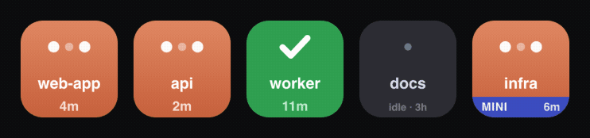

# Claude Sessions

**See which of your Claude Code sessions needs you — at a glance, on an Ulanzi
Stream Deck or in a window on your desktop.**


[](https://github.com/AnilRh/claude-sessions-deck/tags)



Run a bunch of Claude Code sessions at once and it's easy to lose track of which
one is quietly **blocked waiting on you**. Claude Sessions turns each Stream Deck
key — or each tile in a browser window — into a live status light for one
session. The amber "needs you" state is tuned to catch your eye in peripheral
vision, so you never leave Claude stuck.

## Why you'll like it

- **At-a-glance states** — thinking, waiting-on-you, done, idle, error. Recently
  changed tiles briefly glow so "just finished" stands out from your backlog.
- **Unmissable amber** — the "blocked on you" state is the loudest by design.
- **Press to jump** — tap a key (or click a tile) to jump straight to that
  session; press-and-hold to clear it.
- **A web board, with or without a deck** — the same tiles in a resizable window
  you can [Add to Dock](#web-board); or run it [headless](#no-deck-headless-mode)
  with no Stream Deck at all.
- **Multiple machines** — a second machine's sessions show up too, over an SSH
  tunnel you control.
- **OpenAI Codex too** — Codex sessions (CLI, IDE, or the ChatGPT app's Codex
  mode) appear alongside Claude's, marked with a small hexagon.
- **Local-only, no cloud** — everything runs on `127.0.0.1`; no data leaves your
  machine.

**Requirements:** macOS 12+ · Ulanzi Studio 3.0+ · Claude Code. macOS-only (uses
`osascript`, the `claude://` scheme, `~/Library`, `launchd`).

## Quick start

**From a release (no repo checkout):**

1. Download `claude-sessions.ulanziPlugin` from the
   [latest release](https://github.com/AnilRh/claude-sessions-deck/releases).
2. **Double-click** it (if your Studio build supports import), or unzip it into
   `~/Library/Application Support/Ulanzi/UlanziDeck/Plugins/`. Restart Ulanzi
   Studio, then drag **Claude Sessions → Session Slot** onto some keys.
3. Select a Session Slot key to open the Property Inspector and click
   **Claude Code hooks → Install / update**. Without hooks the keys stay empty.

**From source:**

```bash
git clone https://github.com/AnilRh/claude-sessions-deck.git && cd claude-sessions-deck
npm run install:plugin   # copy plugin into Ulanzi Studio + restart it
npm run hooks:install     # wire Claude Code events to the local server (merge-safe)
```

Then drag **Claude Sessions → Session Slot** onto 5–8 adjacent keys. New sessions
appear on keys as they emit events; already-running ones appear on their next
event. (`npm run hooks:uninstall` removes exactly what it added, nothing else.)

## Using it

| Do this | And… |
|---|---|
| Click / press a lit key | jump to that session (and acknowledge a done/error tile) |
| Press-and-hold ≥ 600 ms | clear that slot |

What "jump" means is set by **Focus app** in the settings (Claude Desktop,
a terminal, or `Terminal (resume)`) — see [Configuration](#configuration).

## Web board

The same board, in a window: open <http://127.0.0.1:9210/board> while the plugin
is running. It shows **every** live session (not just the ones with a physical
key), as the same tiles the deck renders, updating live — remote machines
included. Tiles reflow to fill the window, so size it for the grid you want.

Presses behave exactly like the physical keys — **click** = press,
**hold ≥ 600 ms** = clear (same code path, not a reimplementation). To make it a
desktop app, open it in Safari → **File → Add to Dock** and park the window on
whatever Space you like. Works whether or not a deck is plugged in.

## No deck? Headless mode

You don't need a Stream Deck (or Ulanzi Studio) at all — the web board is a full
display on its own:

```bash
git clone https://github.com/AnilRh/claude-sessions-deck.git && cd claude-sessions-deck
npm run hooks:install     # wire Claude Code events to the local server
npm run headless          # start the plugin standalone
```

Then open <http://127.0.0.1:9210/board> and **Add to Dock**. To start it at
login: `npm run headless:agent` (`ACTION=uninstall` removes it). Headless is
detected automatically; config lives in
`com.ulanzi.claudesessions.ulanziPlugin/config.json` (hand-edit and restart — the
Property Inspector is a Studio feature). Don't run headless *and* Ulanzi Studio
together: both contend for the hook port.

## OpenAI Codex too

Codex has a hooks system almost identical to Claude Code's, so its sessions can
share the board. Install the Codex hooks from the Property Inspector (**Codex
hooks → Install / update**) or from a checkout:

```bash
npm run codex-hooks:install    # writes ~/.codex/hooks.json (merge-safe, backup first)
```

Then open Codex and run **`/hooks`** to trust them — Codex skips new or changed
hooks until you do. `/hooks` only works in the Codex *terminal* app, not the ChatGPT
app's chat box; if you only have the ChatGPT app, it ships the CLI — run
`"/Applications/ChatGPT.app/Contents/Resources/codex-cli/bin/codex"` in
Terminal, then type `/hooks`. Codex tiles behave exactly like Claude ones (thinking,
waiting on you, done, plus Codex's *interrupt* → idle), carry a small hexagon in
the top-left corner, and take their names from your Codex thread titles.
Pressing one opens that thread in the ChatGPT app (`codex://threads/<id>`), or
resumes it in Terminal with `codex resume` when **Focus app** is *Terminal
(resume)*. `npm run codex-hooks:uninstall` removes them.

Codex support is **this Mac only** for now: `remote-hooks` installs Claude Code
hooks on a second machine but not Codex ones, and Codex titles are read from this
Mac's `~/.codex`.

## Configuration

Select any Session Slot key in Ulanzi Studio to open the Property Inspector
(settings apply to all keys; persisted in `config.json` in the installed plugin
folder):

| Setting | Default | Notes |
|---|---|---|
| Hook server port | 9210 | must match the port in the installed hooks — rerun `hooks:install` with `CLAUDE_SESSIONS_PORT=<port>` if you change it |
| Stale session timeout | 30 min | sessions with no events are pruned |
| Focus app | Ghostty | Ghostty / iTerm2 / Terminal (app focus); `Terminal (resume)` (open Terminal running `claude --resume`); Claude (Desktop deep-link resume) |
| Button name | Session title | `Session title` (see below) or `Folder name` (cwd basename) |
| Key order | Fixed | `Fixed` (keeps each key's position; a gap appears when one clears) · `Compact` (fill gaps) · `Group: local first` (compact, local before remote) |
| Animate thinking | on | 1 fps frame swap on thinking keys only |

<details>
<summary><b>Button names</b> — titles, <code>[bracket]</code> shortcuts, and fallbacks</summary>

By default a key shows the session's **title**, not the folder — so multiple
sessions in the same directory (e.g. an Obsidian vault) are distinguishable. The
title comes from the session transcript. Precedence:

1. A **`[bracketed]`** hint in the title becomes a short label —
   `premise telephony analysis [phone issue]` shows as `phone issue`. The tidiest
   way to name a key: rename the session with a short bracketed tag.
2. Otherwise the **full title** wraps to two lines (long ones truncate with `…`).
3. If there's no title yet, the **folder name** is used, with `·2`/`·3` to
   disambiguate same-folder sessions.

Set **Button name → Folder name** to always use the folder. Titles are read from
the transcript **when a hook event arrives** (not polled), so a fresh session
shows the folder until its first title lands, then relabels. **Remote sessions**
get titles too, read over SSH right after a remote event; if non-interactive SSH
isn't available it just falls back to the folder name.

</details>

## More

<details>
<summary><b>States &amp; transitions</b></summary>


| State | Tile | Entered on | Left on |
|---|---|---|---|
| `empty` | near-black | slot has no session | session assigned |
| `idle` | lighter card, bright name, `idle · <time>` | acknowledge press | any activity |
| `thinking` | terracotta gradient, pulsing dots (1 fps) | `UserPromptSubmit`, any tool event | `PermissionRequest`/`Notification` → waiting; `Stop` → done; `StopFailure` → error |
| `waiting` | **amber, bold "?"** — Claude is blocked on YOU | `PermissionRequest`, `Notification` | any tool event (heartbeat) → thinking |
| `done_unread` | green, check | `Stop` (turn finished) | key press → idle; new prompt → thinking |
| `error` | **red, bold "!"** — the turn hit an API error | `StopFailure` (rate limit / overloaded / auth) | key press → idle; new prompt or tool event → thinking |

Recently changed done/waiting/error tiles briefly brighten with an accent ring,
settling to normal after a few minutes — so what just happened stands out.
Remote sessions add a machine-colour footer. Tool-level failures
(`PostToolUseFailure`) are heartbeats, not errors — only turn-level `StopFailure`
shows red. On `SessionEnd` a session is kept, not removed (a mid-work session
becomes `done`); slots free on long-press or after the stale timeout.

**The permission-resume gap.** No Claude Code hook fires when work resumes after
you approve a permission dialog. This plugin treats *any* tool event as a
heartbeat back to `thinking`, so a key can show amber for the duration of the
first tool call after an approval, then self-corrects. This is inherent to the
hooks API.

</details>

<details>
<summary><b>Running Claude Code in a terminal</b> (not Claude Desktop)</summary>

The status display works for any Claude Code user with no changes — it's driven
entirely by the hooks. Only the jump-on-press differs:

- Set **Focus app** to `Terminal (resume)` for a real jump: a press opens
  Terminal.app in the session's directory and runs `claude --resume` (a new
  window; if the session is already live elsewhere, `--resume` forks a copy).
- Or set it to your terminal (`Ghostty` / `iTerm2` / `Terminal`) for a lighter
  app-level focus that just raises the terminal.

`Terminal (resume)` uses Terminal.app specifically (reliable `do script`); it
works even if your day-to-day terminal is Ghostty or iTerm2.

</details>

<details>
<summary><b>Security</b> — loopback only, no cloud</summary>

The hook receiver binds `127.0.0.1` and is intentionally unauthenticated: any
local process can POST a session event, exactly like the Claude Code hooks do.
It's not reachable from the LAN, payloads are validated, and the only effect of a
forged event is a wrong tile. Remote machines reach it over an SSH tunnel you set
up. Board *actions* (press/clear) require a custom header **and** a loopback
`Host`, so a website can't trigger them cross-origin. Don't expose the port
beyond loopback. More in [CONTRIBUTING.md](CONTRIBUTING.md#security-model).

</details>

<details>
<summary><b>Troubleshooting</b></summary>

**Run `npm run doctor` first.** It walks the whole chain — Studio, plugin
process, listener/port, hooks, an end-to-end POST, `claude` availability, and
each configured remote machine — and prints the fix for anything wrong.

- **Keys never light up** — check hooks are installed (`grep claude-sessions
  ~/.claude/settings.json`), then `curl -s -o /dev/null -w '%{http_code}'
  http://127.0.0.1:9210/claude-sessions-event -X POST -d '{}'` → expect 200.
  Hooks only attach to sessions started *after* `hooks:install`.
- **Port conflict / EADDRINUSE** — something else owns 9210 (`lsof -nP -i
  :9210`). Change the port in the PI and reinstall hooks with
  `CLAUDE_SESSIONS_PORT=<port> npm run hooks:install`.
- **Key stuck in thinking** — the session died without `SessionEnd`; clears at
  the stale timeout, or long-press now.
- **Key stuck in amber after approving** — expected until the running tool
  finishes (the permission-resume gap).
- **Focus press does nothing** — System Settings → Privacy & Security →
  Automation → allow Ulanzi Studio to control the target app.
- **Codex tiles never appear** — the Codex hooks must be trusted once: run the
  Codex CLI, type `/hooks`, trust them, then restart the ChatGPT app.
- **What is the plugin actually doing?** <http://127.0.0.1:9210/board/stats>
  shows live counters: hook events received, tile pushes to the deck, queued
  pushes, keys, and sessions. `events` not increasing while you work means hooks
  aren't reaching the plugin; `pending` staying high means the deck is behind.

</details>

## Scope

Tracks Claude Code sessions (including the Code tab in Claude Desktop) and
OpenAI Codex sessions — the agents that expose lifecycle hooks. Plain *chat*
conversations in Claude Desktop or the ChatGPT app have no hooks or event API
(confirmed as of October 2026) and are out of scope, as is focusing a *specific* terminal window by session (unreliable).
Multiple deck profiles are supported. macOS-only: the focus/jump, Desktop
integration, and setup scripts use macOS-specific APIs — the status display is
OS-agnostic in principle, but not yet ported to Windows.

Adding a **remote machine** needs a repo checkout — the one-command setup
(`ORIGIN=<label> npm run remote-hooks`, see [MULTI-SERVER.md](MULTI-SERVER.md))
isn't bundled in the release artifact.

## License & credits

MIT — see [LICENSE](LICENSE). Vendors the Ulanzi UlanziDeck SDK
(`plugin/plugin-common-node`, © Ulanzi, used unmodified) whose upstream `LICENSE`
is Apache-2.0 — reproduced alongside the vendored copy. The only runtime
dependency is [`ws`](https://github.com/websockets/ws) (MIT). Building and
internals: [CONTRIBUTING.md](CONTRIBUTING.md).
